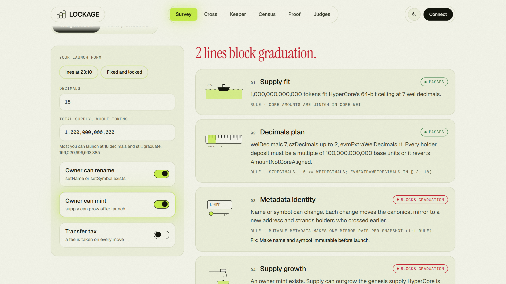
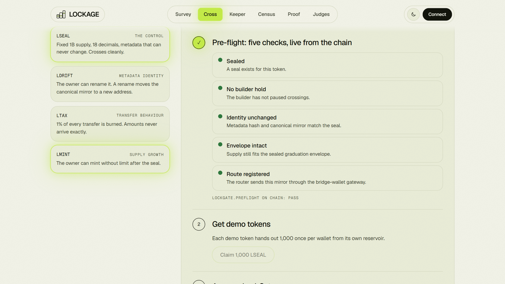
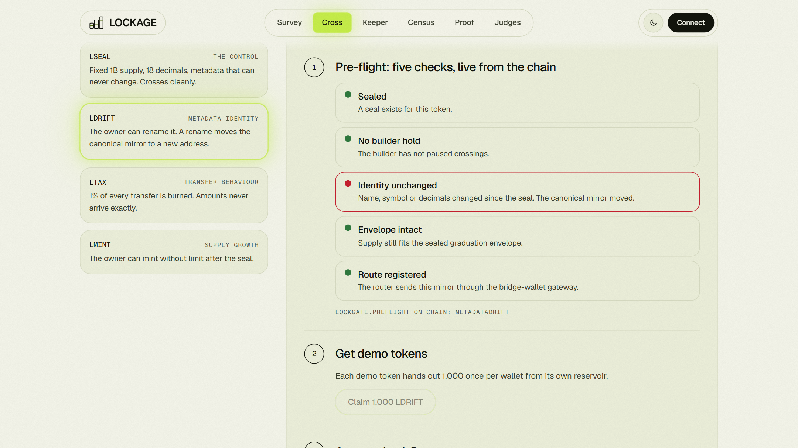
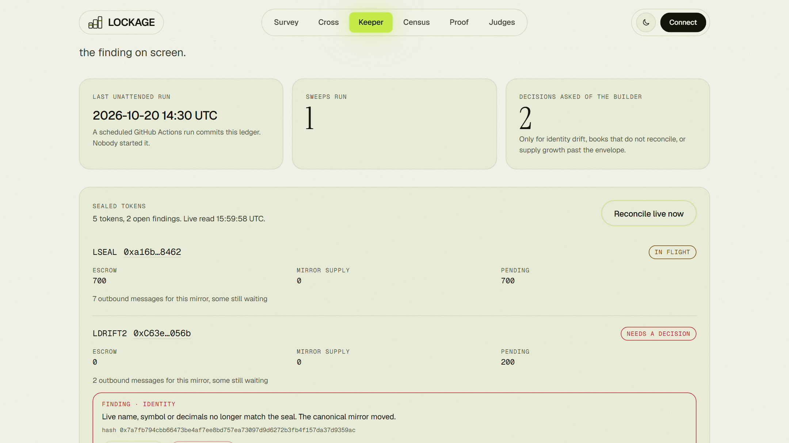
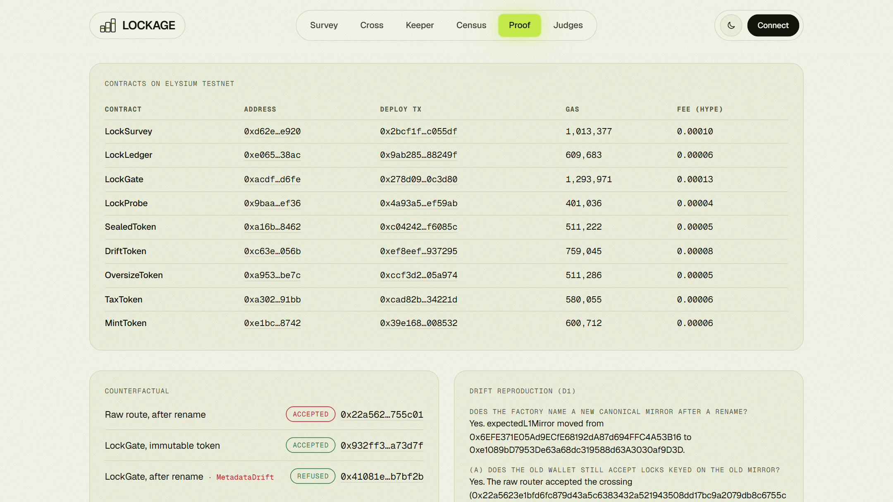
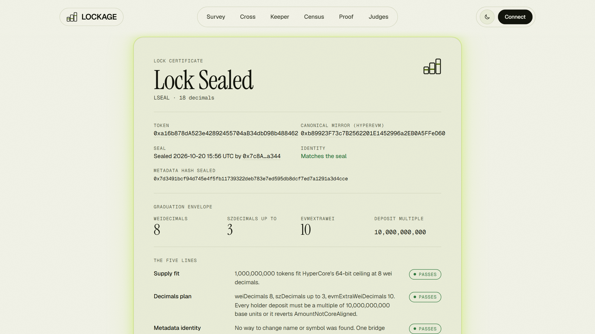
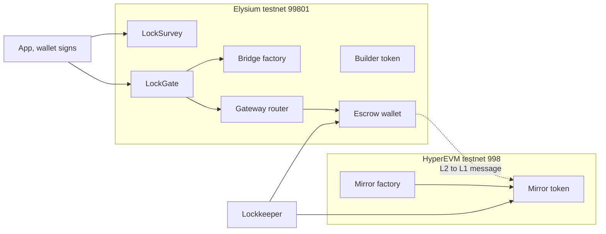
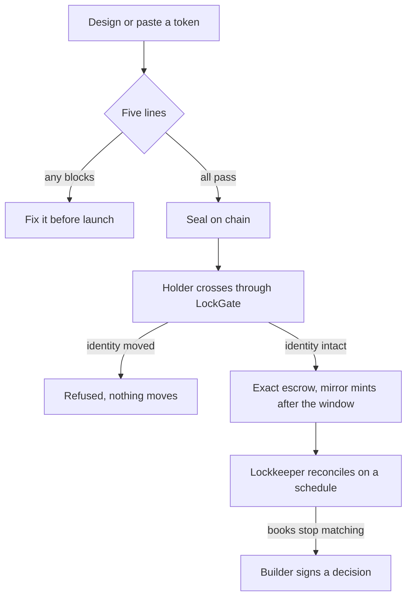

<div align="center">

# LOCKAGE

**Know before you launch on Ascend.**

Whether your token can ever reach a HyperCore orderbook is decided the night you launch it.
LOCKAGE reads that back to you first, seals the token's bridge identity, and refuses any crossing whose route has drifted.

[](https://lockage-kinnoskis-projects.vercel.app)
[](https://github.com/0xkinno/lockage/actions/workflows/ci.yml)
[](#proof-measured-not-claimed)
[](#deployed-contracts)
[](LICENSE)

</div>


| | |
|---|---|
| **Live app** | https://lockage-kinnoskis-projects.vercel.app |
| **Judge walk** | [/judge](https://lockage-kinnoskis-projects.vercel.app/judge): 60 seconds, 3 minutes, 10 minutes |
| **Proof page** | [/proof](https://lockage-kinnoskis-projects.vercel.app/proof): contracts, transaction hashes, measured costs |
| **Census** | [/census](https://lockage-kinnoskis-projects.vercel.app/census): the wild set of Elysium testnet tokens |
| **Network** | Elysium testnet (99801) settling to HyperEVM testnet (998) |
| **Author** | [0xkinno](https://github.com/0xkinno) |

---

## The finding in one paragraph

Everyone assumes a token launched on Elysium can climb to HyperCore later. It cannot, unless five properties were right at launch: supply, decimals, metadata mutability, mintability and transfer behaviour. The climb's third rung is a one-shot, irreversible ceremony whose parameters are permanent, and the mirror bridge keys a token's identity on its live `name`, `symbol` and `decimals`. We reproduced the consequence on chain: **after a single `setSymbol`, the raw router kept accepting crossings keyed on the old mirror, a second escrow wallet could be created for the same token, and only LockGate refused.** Both transactions are below, one accepted and one reverted.

## The problem, in a person

Ines is a solo builder in Porto (a fictional persona). At 23:10 on launch night she types a supply of one trillion because big numbers look cheap, and leaves the owner able to rename the token in case of a rebrand. Four months later HyperCore asks her for permanent choices she can no longer make freely: a coarser granularity than she wanted, a bridge identity her rebrand already moved, and a genesis supply her owner `mint` can outgrow.

None of it is an Elysium bug. It is in the docs, on three pages, written for issuers who already know to look.

| What is true | Source |
|---|---|
| Elysium tokens reach HyperCore through the mirror bridge, then deposit-wallet linkage | [Token bridging on Elysium](https://elysium.kinetiq.xyz/docs/token-bridging-on-elysium) |
| Mirror identity is the token plus its exact live metadata; mutable metadata makes one pair per snapshot | [Token bridging architecture](https://elysium.kinetiq.xyz/docs/token-bridging-architecture) |
| The ticker spec is locked at auction, genesis is one-shot, the link is permanent | [HyperCore spot deployment](https://elysium.kinetiq.xyz/docs/hypercore-spot-deployment) |
| Core amounts are `uint64` Core wei; `szDecimals + 5 <= weiDecimals`; `evmExtraWeiDecimals` in [-2, 18] | same page, step 1 |
| Unaligned deposits revert `AmountNotCoreAligned`; fee-on-transfer and rebasing tokens are unsupported | [Deposit wallets](https://elysium.kinetiq.xyz/docs/hypercore-bridging-via-deposit-wallets) |

## What LOCKAGE does

LOCKAGE is five modules with typed outputs. No model sits in any decision path.

| Module | Where | Job |
|---|---|---|
| **Surveyor** | `LockSurvey.sol`, `src/lib/envelope.ts` | Computes the graduation envelope exactly as HyperCore will, and seals identity |
| **Gauger** | `src/lib/bytecode.ts`, `LockProbe.sol` | Reads what the bytecode can do; measures what transfers actually do |
| **Gatekeeper** | `LockGate.sol` | The only crossing path: refuses on drift, wrong route or inexact escrow |
| **Lockkeeper** | `scripts/lockkeeper.ts` | Reconciles escrow, mirror supply and pending messages on a schedule |
| **Clerk** | `scripts/facts.ts` | Writes `docs/FACTS.json` from real runs. Every number below is read from it |

### The five lines

Each line says **Passes**, **Blocks graduation** or **Not determined**, and cites the rule behind it. When a property cannot be read, LOCKAGE abstains. It never prints a green verdict over a guess.

| # | Line | The rule | Decided by |
|---|---|---|---|
| 1 | Supply fit | Core amounts are `uint64` in Core wei | Exact integer math, twin-tested |
| 2 | Decimals plan | `szDecimals + 5 <= weiDecimals`; deposits must be core-aligned | Exact integer math |
| 3 | Metadata identity | Mirror = token + exact live name, symbol, decimals | Bytecode selectors, then the seal |
| 4 | Supply growth | Escrow must back genesis supply exactly | Bytecode selectors |
| 5 | Transfer behaviour | Fee-on-transfer and rebasing are unsupported | An on-chain probe: measured, not guessed |

### The guarantee, enforced in Solidity

> A crossing through LOCKAGE either lands on the mirror the token was sealed with, through a registered route, with exact escrow, or it reverts before any funds move.

| Refusal | Revert | Proven by |
|---|---|---|
| Token was never sealed | `NotSealed` | unit test |
| Name, symbol or decimals changed | `MetadataDrift` | unit test, **live transaction** |
| Factory now names a different mirror | `MirrorIdentityDrift` | unit test |
| Supply grew past the sealed envelope | `EnvelopeBroken` | unit test |
| Escrow wallet missing, or route not the bridge-wallet gateway | `PairNotDeployed`, `RouteNotRegistered` | unit test, fork test |
| Escrow did not arrive exactly (tax, rebase, lying wallet) | `EscrowShortfall` | unit test |
| Builder pressed the brake | `OnHold` | unit test |
| Reentrancy | `Reentered` | unit test |

## Proof: measured, not claimed

### 1. The drift, reproduced on Elysium testnet

| Step | Outcome | Transaction |
|---|---|---|
| Raw router crossing before the rename | Accepted | [`0xdaae80e2...`](https://elysium.kinetiq.xyz/testnet-explorer/tx/0xdaae80e2c522d5b15ae19a42dd1e677df22d27012b036c45f9f881beeb1456d4) |
| Owner renames the token | Mirror moves to a new address | [`0xc6af76c8...`](https://elysium.kinetiq.xyz/testnet-explorer/tx/0xc6af76c88b60ef134a4d601bc815abc6990bfbc061d019ad0b981b8b11690cc5) |
| Raw router crossing keyed on the stale mirror | **Accepted** | [`0x22a5623e...`](https://elysium.kinetiq.xyz/testnet-explorer/tx/0x22a5623e1bfd6fc879d43a5c6383432a521943508dd17bc9a2079db8c6755c01) |
| LockGate crossing of the immutable token (control) | Accepted | [`0x932ff313...`](https://elysium.kinetiq.xyz/testnet-explorer/tx/0x932ff313d27c0b47e7164986bf0ad3976bf8583ed4b968203fb1644307a73d7f) |
| LockGate crossing of the renamed token | **Refused: MetadataDrift** | [`0x41081ed6...`](https://elysium.kinetiq.xyz/testnet-explorer/tx/0x41081ed61fdd91620cfaf66b1cca2e96d802f3c0fa45b5807755278b86b7bf2b) |

What the experiment answered, by execution rather than by reading docs:

- **Does a rename move the canonical mirror?** Yes. `expectedL1Mirror` changed address.
- **Does the old route still accept locks keyed on the old mirror?** Yes. The router has no memory of the identity change.
- **Can a second escrow wallet be created for the new metadata?** Yes. One token, two wallets.
- **Does LockGate catch it?** Yes, before any funds move, and the refusal is recorded on chain.
- **Do two mirrors end up with nonzero supply?** Not yet determined. Supply only mints after the challenge window, and the keeper re-reads it when the window passes.

### 2. The wild set

The scan found **1,096,760** ERC-20 emitters on Elysium testnet. 850,832 emitted exactly one Transfer and 242,619 exactly two: single-mint deployment spam, counted and published but not surveyed. LOCKAGE surveyed the **3,249** contracts with at least 3 transfers.

| Measure | Result |
|---|---|
| Clear on the four lines a scan can read | **74%** (2,390) |
| Blocked by supply or decimals | 626 |
| Owner mint found | 122 |
| Mutable metadata found by selector scan | 0 |
| Unreadable proxies (reported as Not determined) | 229 |
| Already paired with an escrow wallet on the bridge | 1,002 |

The selector scan is a heuristic, so it is scored. A control set of 30 tokens is labelled by **execution** (simulating `mint` and rename calls as the owner), a different method from the one under test. Both error directions are published and every miss is named on [/census](https://lockage-kinnoskis-projects.vercel.app/census).

### 3. The envelope against ground truth

The formula was checked against HyperCore testnet's own token list (1,673 tokens, 80 with linked EVM contracts). 72 are consistent with the rules; the exceptions (the system token USDC and tokens whose reported max supply sits at the hard `uint64` ceiling) are named in `data/envelope-verification.json`. LOCKAGE plans 10% below that ceiling on purpose, so it is stricter than HyperCore itself.

### 4. Tests

**68** Foundry tests pass, fuzzed at 10,000 runs per property. The Solidity and TypeScript envelopes are fed the same **10,000** vectors and must agree exactly. Fork tests run LockGate against the real factory, router and bridge-wallet gateway. A browser suite on six viewports drives a **real EIP-6963 wallet signing real testnet transactions**: claim, approve, cross, refusal, seal, probe, certificate, keeper decision.

## Screenshots

| Survey: Ines at 23:10 | Cross: five live checks |
|---|---|
|  |  |
| **Cross: refused after the rename** | **Keeper: unattended reconciliation** |
|  |  |
| **Proof: contracts and transactions** | **Lock Certificate** |
|  |  |

## Deployed contracts

Elysium testnet (99801), deployed 2026-10-20 by `0x7c8A...a344`. Total deployment cost: 0.00063 HYPE for all nine contracts.

| Contract | Role | Address | Deploy tx | Gas |
|---|---|---|---|---|
| `LockSurvey` | Envelope math, metadata hash, seal | [`0xd62e...e920`](https://elysium.kinetiq.xyz/testnet-explorer/address/0xd62ec5f3fe3e97b25f0276db59e9be188d68e920) | [`0x2bcf1f77...`](https://elysium.kinetiq.xyz/testnet-explorer/tx/0x2bcf1f771e662dcc92f74099ab664cbb20875a361fbc0604d285ca389cc055df) | 1,013,377 |
| `LockLedger` | Builder decisions bound to a finding hash; holds | [`0xe065...38ac`](https://elysium.kinetiq.xyz/testnet-explorer/address/0xe0651987e8992b51b2ee0d73883777810a4938ac) | [`0x9ab285e2...`](https://elysium.kinetiq.xyz/testnet-explorer/tx/0x9ab285e223971bf87f15c17b5b324fa935c602e366394da42c18b811c388249f) | 609,683 |
| `LockGate` | The enforcement point for crossings | [`0xacdf...d6fe`](https://elysium.kinetiq.xyz/testnet-explorer/address/0xacdfa87818a91f68c4ccf89ef0375e7984f4d6fe) | [`0x278d0968...`](https://elysium.kinetiq.xyz/testnet-explorer/tx/0x278d09687e82000d6239534616ede18cb4d8150cd941d5ddd0d052306d0c3d80) | 1,293,971 |
| `LockProbe` | Measures whether transfers deliver exactly what is sent | [`0x9baa...ef36`](https://elysium.kinetiq.xyz/testnet-explorer/address/0x9baac75a4e0e12dd6ed7fd70b1f844c9b8f3ef36) | [`0x4a93a568...`](https://elysium.kinetiq.xyz/testnet-explorer/tx/0x4a93a568d302939a3b046bc10863ef2392838bd4c6c38905c6780d4eb4ef59ab) | 401,036 |
| `SealedToken` | Demo: fixed 1B supply, immutable metadata (the control) | [`0xa16b...8462`](https://elysium.kinetiq.xyz/testnet-explorer/address/0xa16b878da523e42892455704ab34dbd98b488462) | [`0xc04242ce...`](https://elysium.kinetiq.xyz/testnet-explorer/tx/0xc04242ce9b74efcff7b0b5a223b6d8b40a0e9ac7335932c30d1fa5d14af6085c) | 511,222 |
| `DriftToken` | Demo: the owner can rename it (the drift case) | [`0xc63e...056b`](https://elysium.kinetiq.xyz/testnet-explorer/address/0xc63edc7f5b55f7c1ad905e949e18e5552f10056b) | [`0xef8eefc3...`](https://elysium.kinetiq.xyz/testnet-explorer/tx/0xef8eefc31e194972662a87ee02c5497a4514796e052d144d91aee70f8b937295) | 759,045 |
| `OversizeToken` | Demo: 1 quadrillion supply, cannot graduate | [`0xa953...be7c`](https://elysium.kinetiq.xyz/testnet-explorer/address/0xa9539fd9c256f8b19f3fd4759eda9c90edbbbe7c) | [`0xccf3d224...`](https://elysium.kinetiq.xyz/testnet-explorer/tx/0xccf3d2249438f852f6655e33e247b8142bf9a689acf0590b2c241f034f05a974) | 511,286 |
| `TaxToken` | Demo: 1% transfer tax | [`0xa302...91bb`](https://elysium.kinetiq.xyz/testnet-explorer/address/0xa302f4331b6be3013b5acbb7ef0c093dcfcb91bb) | [`0xcad82b0b...`](https://elysium.kinetiq.xyz/testnet-explorer/tx/0xcad82b0b3c6244fdf5ea20f3912fe3ce2dfb1c58cd1e185e7fe0c775d534221d) | 580,055 |
| `MintToken` | Demo: the owner can mint | [`0xe1bc...8742`](https://elysium.kinetiq.xyz/testnet-explorer/address/0xe1bccd5e9a0a800d7337a534e4b27a24e5498742) | [`0x39e1688a...`](https://elysium.kinetiq.xyz/testnet-explorer/tx/0x39e1688a1c0fdfb685aa5fede297364edcfa7dfac9bbb104d889964320008532) | 600,712 |

### Bridge pairs

Each demo token has a live escrow wallet and a registered HyperEVM mirror. LBIG is sealed only: it can never graduate, so it has no pair on purpose. The LDRIFT row shows the token **after** its rename: the mirror and wallet are the second pair created for the new metadata.

| Token | Elysium token | HyperEVM mirror | Escrow wallet | Router route |
|---|---|---|---|---|
| LSEAL | [`0xa16b...8462`](https://elysium.kinetiq.xyz/testnet-explorer/address/0xa16b878da523e42892455704ab34dbd98b488462) | [`0xb899...eD60`](https://testnet.hyperevm-explorer.xyz/address/0xb89923F73c7B2562201E1452996a2EB0A5FFeD60) | [`0x0A84...1bd7`](https://elysium.kinetiq.xyz/testnet-explorer/address/0x0A84c16fF667FB4CdaC0A6Cd61d4d6171E3b1bd7) | registered |
| LDRIFT2 | [`0xc63e...056b`](https://elysium.kinetiq.xyz/testnet-explorer/address/0xc63edc7f5b55f7c1ad905e949e18e5552f10056b) | [`0xe108...9D3D`](https://testnet.hyperevm-explorer.xyz/address/0xe1089bD7953De63a68dc319588d63A3030af9D3D) | [`0xaE8c...2a30`](https://elysium.kinetiq.xyz/testnet-explorer/address/0xaE8cf79EE5088B263670C2d056a2F59c9E6c2a30) | registered |
| LTAX | [`0xa302...91bb`](https://elysium.kinetiq.xyz/testnet-explorer/address/0xa302f4331b6be3013b5acbb7ef0c093dcfcb91bb) | [`0x3553...30df`](https://testnet.hyperevm-explorer.xyz/address/0x3553D9DAB2c1De0f7b38bFca664cC1f028A430df) | [`0x0d2F...7275`](https://elysium.kinetiq.xyz/testnet-explorer/address/0x0d2FF591F807435197B005a83A1964851Ef27275) | registered |
| LMINT | [`0xe1bc...8742`](https://elysium.kinetiq.xyz/testnet-explorer/address/0xe1bccd5e9a0a800d7337a534e4b27a24e5498742) | [`0x3A39...05CA`](https://testnet.hyperevm-explorer.xyz/address/0x3A39f45e5691631D86F704F92Ee4f58F470305CA) | [`0x40D5...1EF7`](https://elysium.kinetiq.xyz/testnet-explorer/address/0x40D564C05F12778040057ed063e996C579251EF7) | registered |
| LBIG | [`0xa953...be7c`](https://elysium.kinetiq.xyz/testnet-explorer/address/0xa9539fd9c256f8b19f3fd4759eda9c90edbbbe7c) | [`0xcB7f...dF86`](https://testnet.hyperevm-explorer.xyz/address/0xcB7fCF2fdABc7D212C082a3098f1ED22E998dF86) | none, by design | not bridged |

### Elysium infrastructure used

| Component | Address |
|---|---|
| Bridge factory | [`0xb94A...BE5a`](https://elysium.kinetiq.xyz/testnet-explorer/address/0xb94A38a4aC46970559E89E566f2486a3Fc56BE5a) |
| Gateway router | [`0x8965...c718`](https://elysium.kinetiq.xyz/testnet-explorer/address/0x89659883a9d980925733B0A698F117AAb65ac718) |
| Bridge-wallet gateway | [`0x7255...F959`](https://elysium.kinetiq.xyz/testnet-explorer/address/0x7255150a0340852Fe4B4B5657C5AcE6c09a4F959) |
| ArbSys | `0x0000...0064` |
| Mirror factory (HyperEVM) | [`0xcaDb...290b`](https://testnet.hyperevm-explorer.xyz/address/0xcaDb9986F3727177d48FA07294E1730f9D19290b) |
| Outbox (HyperEVM) | [`0x8739...1060`](https://testnet.hyperevm-explorer.xyz/address/0x87391D602aaffB3Fe8051EcCDb75d6EEe8C31060) |

## Architecture



```text
 HyperCore   ......................... spot orderbook, the third rung
                                            ^
 HyperEVM    [ mirror token ] <---- gate two: output root, then the challenge window
                  ^
 Elysium     [ token ] --> [ LockGate ] --> [ escrow wallet ]
                           gate one: seal, route, exact escrow
```



### Trust model

| Question | Answer |
|---|---|
| Who can move user funds? | Only the user's own wallet. There is no server key. The lockkeeper is read-only |
| What is decided on chain? | The envelope, the seal, every crossing refusal, escrow exactness, builder holds |
| What is heuristic? | Whether bytecode can mint or rename. Misses are scored and published |
| Who can re-pin a drifted identity? | The sealer or the token's own `owner()`, never a stranger |
| What happens when LOCKAGE cannot tell? | It says Not determined and explains what would settle it |
| What if an RPC is down? | The app names which source answered, and never falls back silently |

The adversarial review is in [docs/REDTEAM_LOG.md](docs/REDTEAM_LOG.md): five roles attacked the build in two rounds, and every finding was fixed or recorded.

## Elysium, used specifically

| Feature | Where | Use |
|---|---|---|
| Bridge factory `expectedL1Mirror`, `l2WalletFor` | `LockSurvey.sol`, `LockGate.sol` | Names the canonical mirror and escrow wallet at call time |
| Gateway router `getGateway`, `outboundTransfer` | `LockGate.sol` | Verifies the route and sends the crossing; a contract caller works on the live gateway |
| Bridge-wallet gateway | `LockGate.sol` | The only route a sealed token may cross through |
| Mirror factory `createAndRegisterL1Mirror` | `scripts/_bridge.ts` | Registers a mirror for the exact live metadata |
| ArbSys `L2ToL1Tx`, HyperEVM Outbox `isSpent` | `src/lib/keeper.ts` | Counts pending messages, so the books reconcile after finality |
| HyperEVM Bridge `SendRootUpdated` | `scripts/measure-window.ts` | Measures the challenge window |

**Not used, so not claimed:** the HyperCore read precompile and ElysiumCoreWriter (not shipped yet) and the deposit-wallet factory (not published yet). The deposit-wallet leg is computed, not executed.

## Live versus designed

| Capability | State |
|---|---|
| Survey, envelope, Lock Certificate | Live on testnet |
| Seal, probe, LockGate crossing, builder decisions | Live on testnet, driven end to end by the browser suite with a real wallet |
| Drift refusal as a recorded reverted transaction | Live on testnet, hashes above |
| Lockkeeper reconciliation | Live; scheduled runs commit the ledger (2 sweeps so far) |
| Challenge window | Measured automatically once the output root is posted (pending seconds) |
| Deposit-wallet leg and HyperCore genesis | Designed, waiting on Kinetiq's factory |
| Core supply reconciliation on chain | Designed, waiting on the read precompile |

## Judging criteria map

| Criterion | Where to look |
|---|---|
| **Execution** | Nine deployed contracts, 68 tests, a real-wallet browser suite, a live Vercel deployment, an unattended workflow |
| **Usefulness** | The five lines before launch, a crossing that cannot land on a stale route, a printable certificate, a census of the wild set |
| **Long-term vision** | `$LOCK` and the roadmap below, tied to Elysium's own schedule |
| **Originality** | The envelope computed exactly as HyperCore will, sealed bridge identity, a gate that refuses on drift, and a drift reproduced on chain. See [docs/DISCOVERY.md](docs/DISCOVERY.md) |

## `$LOCK` and the roadmap

| Stage | State |
|---|---|
| **Working** | Contracts, app, census and keeper on Elysium testnet |
| **In development** | Deposit-wallet leg: LockGate extends from HyperEVM into HyperCore deposits with `AmountNotCoreAligned` pre-checks, once Kinetiq publishes the factory |
| **Before launch** | Mainnet redeploy at Elysium mainnet launch; a public seal and certificate for `$LOCK` |
| **After launch** | **The toll:** surveys and holder crossings stay free; projects pay for a Graduation Package (sealed certificate, continuous keeper coverage, the scripted ceremony). Tolls fund `$LOCK` buybacks. Holders vote which Ascend launches get free coverage |

Ask of Ascend: a slot in the launch form for the envelope check, and an introduction to Kinetiq for early deposit-wallet factory addresses.

## Honest notes

- Testnet only. No mainnet funds are used.
- The selector scan cannot prove a negative. It is scored against ground truth and its misses are named.
- The census reads Transfer logs, so a contract that never emitted one is not seen, and the transfer-behaviour line stays "not measured" there because the probe needs a signed transaction.
- Items still unknown are listed, with what would settle them, in [docs/DISCOVERY.md](docs/DISCOVERY.md).

## Run it

```bash
npm install
npm run gen               # vectors, contract build, ABIs
npm run test:contracts    # offline tests, 10,000-vector twin equality
npm run dev               # http://localhost:3107
```

Reproduce the on-chain evidence with funded testnet wallets (see [docs/WALLETS.md](docs/WALLETS.md)):

```bash
npm run go-live          # deploy, seal, pair, drift experiment, keeper sweep, FACTS, README
```

| Path | What |
|---|---|
| `contracts/src` | LockSurvey, LockGate, LockProbe, LockLedger, demo tokens |
| `contracts/test` | Unit, fuzz, twin and fork tests |
| `src/lib`, `src/app`, `src/components` | Envelope twin, gauger, survey, keeper, and the app |
| `scripts` | Deploy, setup, experiments, census, lockkeeper, facts |
| `data` | Committed outputs of every dated run |
| `docs` | Discovery, proof plan, evidence, judge guide, FACTS |

Linked docs: [EVIDENCE](docs/EVIDENCE.md), [PROOF](docs/PROOF.md), [DISCOVERY](docs/DISCOVERY.md), [THESIS](docs/THESIS.md), [JUDGE](docs/JUDGE.md), [TASK](docs/TASK.md), [PROGRESS](docs/PROGRESS.md), [MILESTONES](docs/MILESTONES.md).

## Disclosures

AI assistants were used while building. Ines Moraes and Rahul are fictional personas. The demo tokens are ours.

MIT licensed. Built by [0xkinno](https://github.com/0xkinno) for the Ascend x Elysium Builder Competition.
