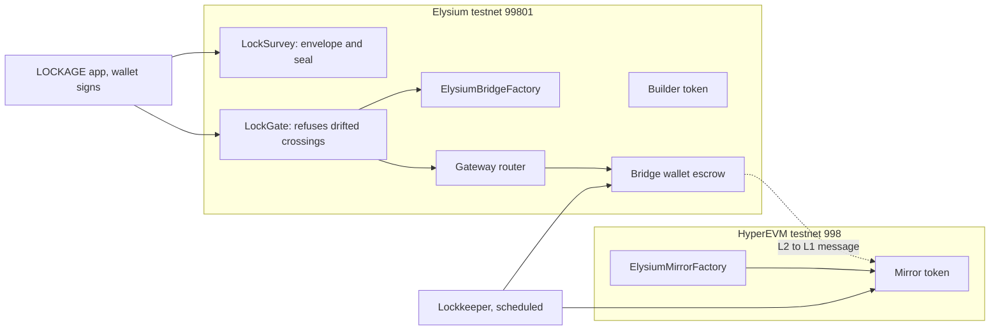
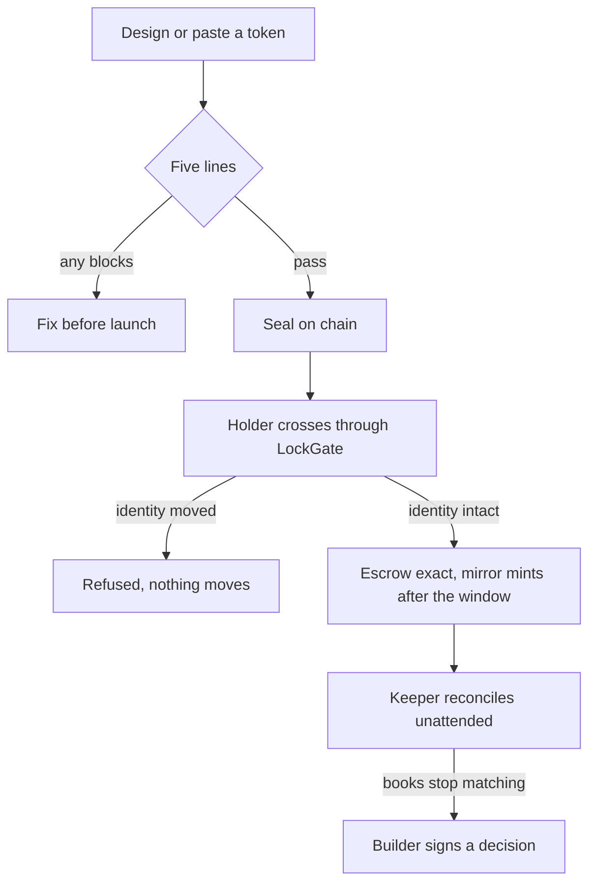

# LOCKAGE

[](.github/workflows/ci.yml) [](LICENSE) [](docs/EVIDENCE.md)

LOCKAGE tells you, before you launch on Ascend, whether your token can ever reach a HyperCore orderbook, and keeps your holders on the one bridge route that is still real.


Ines is launching her first token at 23:10 and types a supply of one trillion with a rename switch left on. Four months later the HyperCore ceremony makes those choices permanent. LOCKAGE reads the five things HyperCore will hold her to, seals the token's bridge identity, and refuses any crossing whose route has drifted from the seal.

| | |
|---|---|
| Live | set by the Vercel deployment (see `docs/SUBMISSION_ASCEND.md`) |
| For judges | `/judge` |
| Video | recorded by the team, script in `docs/SUBMISSION_ASCEND.md` |
| Contracts | `/proof` |
| Census | `/census` |
| Network | Elysium testnet 99801, HyperEVM testnet 998 |

## Screenshots

| Survey | Cross |
|---|---|
|  |  |
|  |  |

## The problem

Ines is a fictional persona. Every Ascend project is sold a four-stage ladder: Launch, Ascended, HyperCore Spot, HIP-3 perps. The third rung is a one-shot, irreversible ceremony. It is gated by facts she fixed at launch without knowing they mattered: decimals, total supply, mintability, transfer tax, and whether the name and symbol can change.

| What is true | Source |
|---|---|
| Elysium tokens reach HyperCore through the mirror bridge, then deposit-wallet linkage | elysium.kinetiq.xyz/docs/token-bridging-on-elysium |
| Mirror identity is the token plus its exact live metadata; mutable metadata makes one pair per snapshot | elysium.kinetiq.xyz/docs/token-bridging-architecture |
| The ticker spec is locked at auction, genesis is one-shot, the link is permanent | elysium.kinetiq.xyz/docs/hypercore-spot-deployment |
| Core amounts are uint64 Core wei; `szDecimals + 5 <= weiDecimals`; `evmExtraWeiDecimals` in [-2, 18] | same page, step 1 |
| Unaligned deposits revert `AmountNotCoreAligned`; fee-on-transfer and rebasing tokens are unsupported | elysium.kinetiq.xyz/docs/hypercore-bridging-via-deposit-wallets |

## What it does

1. **Survey.** Type a design or paste a token. Five lines, each Passes, Blocks graduation, or Not determined, each citing its rule.
2. **Seal.** One wallet-signed transaction records the metadata hash and the canonical mirror.
3. **Cross.** Holders cross through LockGate. It re-reads the factory and router at call time and reverts if anything moved.
4. **Keep.** A scheduled lockkeeper reconciles escrow against mirror supply plus pending messages and asks for a decision only when the books stop matching.
5. **Certify.** A printable Lock Certificate for holders and Ascend.

**What it will not do**, with the file that refuses it:

| Refusal | File |
|---|---|
| A crossing keyed on a mirror the factory no longer calls canonical | `contracts/src/LockGate.sol` (`MetadataDrift`, `MirrorIdentityDrift`) |
| A crossing through any gateway but the bridge-wallet gateway | `LockGate.sol` (`RouteNotRegistered`) |
| A crossing whose escrow does not arrive exactly | `LockGate.sol` (`EscrowShortfall`) |
| A crossing while the builder holds the token | `LockGate.sol` and `LockLedger.sol` (`OnHold`) |
| Printing a green verdict over something it could not read | `src/lib/survey.ts` (Not determined) |
| Re-pinning a drifted identity by a stranger | `LockSurvey.sol` (`NotSealAuthority`) |

## Explore in 2 minutes

Open `/judge`. The 60-second walk needs no wallet.

## Architecture



```text
 HyperCore    ........................ spot orderbook (the third rung)
                                          ^
 HyperEVM     [ mirror token ] <-- gate two: output root, challenge window
                    ^
 Elysium      [ token ] --> [ LockGate ] --> [ escrow wallet ]
                              gate one: seal, route, exact escrow
```



## Elysium, used specifically

| Feature | File | What it does here |
|---|---|---|
| Bridge factory `expectedL1Mirror`, `l2WalletFor` | `contracts/src/LockSurvey.sol`, `LockGate.sol` | Names the canonical mirror and the escrow wallet at call time |
| Gateway router `getGateway`, `outboundTransfer` | `contracts/src/LockGate.sol` | Checks the route and sends the crossing |
| Bridge-wallet gateway | `contracts/src/LockGate.sol` | The only route a sealed token may cross through |
| Mirror factory `createAndRegisterL1Mirror` | `scripts/_bridge.ts` | Registers a mirror for the exact live metadata |
| ArbSys `L2ToL1Tx` and HyperEVM Outbox `isSpent` | `src/lib/keeper.ts` | Counts pending messages so the books reconcile after finality |
| HyperEVM Bridge `SendRootUpdated` | `scripts/measure-window.ts` | Measures the challenge window |

**Not used, so not claimed:** the HyperCore read precompile and ElysiumCoreWriter (not shipped yet, roadmap) and the deposit-wallet factory (not published yet). The deposit-wallet leg is computed, not executed.

## Live versus designed

| Capability | Status |
|---|---|
| Survey (design mode and live token reads), envelope, certificate | Working: runs against the live testnet RPCs today |
| Seal, probe, LockGate crossing, builder decisions | Built, unit tested and fork tested against the live gateway. First signed testnet run is recorded in `/proof` after `npm run go-live` |
| Drift refusal as a recorded reverted transaction | Scripted (`npm run experiment:drift`); hashes appear in `/proof` once run |
| Lockkeeper reconciliation | Built; the first unattended run is committed by the scheduled workflow |
| Deposit-wallet leg and HyperCore genesis | Designed, waiting on Kinetiq's factory |
| Core supply reconciliation on chain | Designed, waiting on the read precompile |

## Measured

All numbers below are rendered from `docs/FACTS.json`.

| Measure | Value |
|---|---|
| Contract tests | {{fact:tests.total}} total, {{fact:tests.passed}} passing, fuzzed at {{fact:tests.fuzzRunsPerProperty}} runs |
| Solidity and TypeScript envelope agree on | {{fact:tests.twinVectors}} vectors |
| ERC-20 emitters seen on Elysium testnet | {{fact:census.candidates}} |
| Surveyed (at least {{fact:census.minTransfers}} transfers) | {{fact:census.surveyed}} |
| Clear on the four lines a scan can read | {{pct:census.canGraduateAsIs,census.surveyed}} ({{fact:census.canGraduateAsIs}}) |
| Blocked by supply or decimals | {{fact:census.blockedBySupplyOrDecimals}} |
| Owner mint found | {{fact:census.mintable}} |
| Mutable metadata found | {{fact:census.mutableMetadata}} |
| Challenge window (seconds) | {{fact:challengeWindowSeconds}} |
| Lockkeeper sweeps run | {{fact:keeper.sweeps}} |
| Decisions asked of the builder | {{fact:keeper.decisionsAsked}} |
| HyperCore testnet tokens used as ground truth | {{fact:envelopeVerification.spotTokens}} |

The control set scores the selector heuristic against ground truth by execution, in both error directions, with every miss named on `/census`.

## Judging criteria map

| Criterion | Where to look |
|---|---|
| Execution | Contracts and tests in `contracts/`, the app in `src/`, the unattended workflow in `.github/workflows/lockkeeper.yml` |
| Usefulness | `/survey` and `/cross`, the census numbers, the Lock Certificate |
| Long-term vision | The `$LOCK` plan below and `docs/SUBMISSION_ASCEND.md` |
| Originality | The envelope computed exactly as HyperCore will, mirror identity sealing, and a gate that refuses on drift. `docs/DISCOVERY.md` |

## $LOCK and the launch plan

| Stage | State |
|---|---|
| Working | Contracts, app, census and keeper on Elysium testnet |
| In development | Deposit-wallet leg, once Kinetiq publishes the factory |
| Before launch | Mainnet redeploy at Elysium mainnet launch; a public seal for `$LOCK` |
| After launch | The toll: a Graduation Package (certificate, continuous keeper coverage, scripted ceremony) that funds `$LOCK` buybacks. Holders vote which Ascend launches get free coverage. |

## Honest notes

- Testnet only. No mainnet funds are used.
- The selector scan is a heuristic. It cannot prove a negative. Misses are published.
- The census reads Transfer logs, so a contract that never emitted one is not seen, and contracts with fewer than {{fact:census.minTransfers}} transfers (deployment spam) are counted but not surveyed.
- Several results are UNKNOWN until a run is recorded; `docs/DISCOVERY.md` lists each.
- The contract-caller crossing through the live gateway was first proven in a fork simulation with an ArbSys stand-in. The signed testnet transaction is in the counterfactual record once run.

## Disclosures

AI assistants were used while building. Ines Moraes and Rahul are fictional personas. The demo tokens are ours.

## Run it locally

```bash
npm install
npm run gen          # vectors, contract build, ABIs
npm run test:contracts
npm run dev          # http://localhost:3107
```

## Repository map

| Path | What |
|---|---|
| `contracts/src` | LockSurvey, LockGate, LockProbe, LockLedger, demo tokens |
| `contracts/test` | 68 offline tests plus fork tests against the live gateway |
| `src/lib` | envelope twin, bytecode gauger, survey logic, chain reads, keeper |
| `src/app`, `src/components` | the app |
| `scripts` | deploy, setup, experiments, census, lockkeeper, facts |
| `data` | committed run outputs |
| `docs` | discovery, proof plan, evidence, judge guide, FACTS |

Linked docs: [EVIDENCE](docs/EVIDENCE.md), [PROOF](docs/PROOF.md), [TASK](docs/TASK.md), [PROGRESS](docs/PROGRESS.md), [MILESTONES](docs/MILESTONES.md), [DISCOVERY](docs/DISCOVERY.md), [THESIS](docs/THESIS.md), [JUDGE](docs/JUDGE.md).

MIT licensed. Author: 0xkinno.
